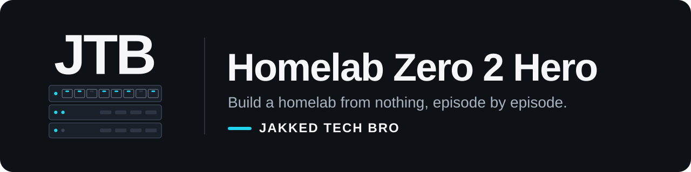
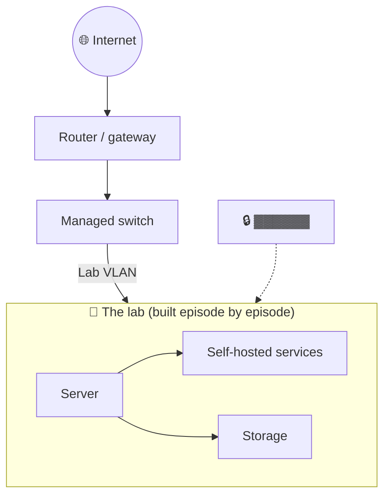

<p align="center">
  
</p>

<p align="center">
  <a href="https://jakkedtechbro.github.io/Homelab-Zero-2-Hero/"></a>
  <a href="https://github.com/JakkedTechBro/Homelab-Zero-2-Hero/discussions"></a>
  <!-- <a href="https://discord.gg/YOUR-INVITE"></a> -->
  <a href="LICENSE"></a>
</p>

<p align="center">
  <b>Build a homelab from nothing, episode by episode.</b><br>
  Free software, affordable gear, and every step explained so you can copy it.
</p>

---

## 👋 What is this?

I'm building a brand-new homelab **from an empty corner** and documenting every step as a video series. This repo is the written companion: each episode gets a guide you can follow at your own pace, with the commands, configs and the *why* behind them.

You don't need a lab, a rack or any experience to start. If you can follow a recipe, you can follow this.

> [!TIP]
> **New here?** Start with the [Roadmap](docs/roadmap.md), then [Ep00 · Documentation setup](docs/episodes/ep00-documentation-setup.md). Or read everything as a website: **[the guide site](https://jakkedtechbro.github.io/Homelab-Zero-2-Hero/)**.

## 🎬 Episodes

> [!NOTE]
> Episodes unlock as the videos drop. 🔒 = coming soon. No spoilers. 😉

| # | Episode | Guide | Video |
|---|---|---|---|
| 00 | Documentation setup (behind the scenes) | [📘 Guide](docs/episodes/ep00-documentation-setup.md) | Coming soon |
| 01 | Trailer | — | [🎬 Watch](https://www.instagram.com/reel/Df0bnVlvBBL/) |

## 🗺️ Roadmap

| Phase | | Status |
|---|---|---|
| **0** | The corner | 2 of 4 unlocked |
| **1** | Hardware and network | 🔒 6 episodes |
| **2** | Services | 🔒 6 episodes |
| **3** | Security | 🔒 3 episodes |
| **4** | AI | 🔒 3 episodes |
| **5** | Azure | 🔒 3 episodes |
| **6** | Kubernetes | 🔒 2 episodes |
| **7** | Two labs, one home | 🔒 3 episodes |

Full roadmap: [docs/roadmap.md](docs/roadmap.md)

## 🧱 What we're building



## 📂 How this repo is organized

<details>
<summary><b>Folder layout</b></summary>

```
Homelab-Zero-2-Hero/
├── README.md              ← you are here
├── docs/                  ← every guide (this also builds the website)
│   ├── index.md
│   ├── roadmap.md
│   ├── episodes/          ← one guide per episode: epNN-short-name.md
│   ├── reference/         ← glossary and cheat sheets
│   └── assets/            ← images and diagrams
├── templates/             ← the template each guide starts from
├── mkdocs.yml             ← website settings
└── .github/               ← website auto-publish + issue/discussion forms
```

</details>

## 🙋 Questions and help

- **Stuck on a step?** Ask in [Discussions → Q&A](https://github.com/JakkedTechBro/Homelab-Zero-2-Hero/discussions/categories/q-a).
- **Found a mistake in a guide?** [Open an issue](https://github.com/JakkedTechBro/Homelab-Zero-2-Hero/issues/new/choose).
- **Built something?** Show it off in [Show and tell](https://github.com/JakkedTechBro/Homelab-Zero-2-Hero/discussions/categories/show-and-tell).

> [!WARNING]
> This repo is public. Never post passwords, API keys, tokens, `.env` contents or your public IP in issues or discussions.

## 📄 License

[MIT](LICENSE). Copy the configs, remix the guides, build your own lab. Just keep the credit.

<p align="center"><sub>Built by <b>Jakked Tech Bro</b> · everyone starts at zero ✊🏿</sub></p>
