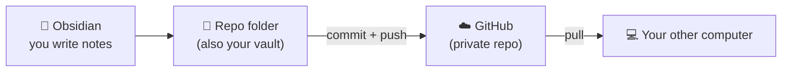

# Ep00 · Documentation setup

> Set up a free system to document your homelab: Git for history, GitHub for backup and sync, Obsidian for taking notes. All three work together, so your notes *are* your backup.

## ✅ Prerequisites

- A Windows or Mac computer
- A free [GitHub](https://github.com) account
- [Obsidian](https://obsidian.md) installed (free)
- About 30 minutes

## 🎯 What you'll learn

- What Git and GitHub are, and why homelabbers document everything
- How to make a **private** repo for your real lab details
- How to make your repo double as an Obsidian vault
- How to keep secrets out of Git with `.gitignore`
- How to sync your notes automatically between computers

> [!NOTE]
> **The idea in one sentence:** Git is a save button with a time machine, GitHub keeps those saves online, and Obsidian is the notebook you write in.



## 🔁 Replace these values

| Placeholder | Replace with | Example |
|---|---|---|
| `<username>` | Your GitHub username | `octocat` |
| `<repo-name>` | Your repo's name | `my-homelab` |
| `<noreply-email>` | Your GitHub no-reply email (Step 3) | `12345+octocat@users.noreply.github.com` |

## 🛠️ Steps

### Step 1 · Create a private repo on GitHub

1. On github.com, click **+** → **New repository**.
2. Name it (e.g. `my-homelab`) and set it to **Private**.
3. Leave **Add a README** **unchecked**.

**Why private?** Your real IPs, hostnames and configs go here. Private means only you can see it.

**Why no README?** If GitHub creates a first commit and your computer creates a different one, they argue when you push. Starting empty avoids that.

### Step 2 · Install Git

**Windows:** open **PowerShell** (not Command Prompt, and not as administrator) and run:

```powershell
# install Git using Windows' built-in package manager
winget install --id Git.Git -e --source winget
```

Then **close PowerShell and open a new window**, so it can find Git.

**Mac:** open **Terminal** and run `git --version`. If Git isn't installed, macOS offers to install it (with Apple's developer tools).

Check it installed:

```powershell
# prints a version number if Git is installed
git --version
```

### Step 3 · Tell Git who you are (privately)

On GitHub, go to **Settings → Emails**, tick **Keep my email addresses private**, and copy the `...@users.noreply.github.com` address.

```powershell
# your name on every commit
git config --global user.name "<your-name>"

# your no-reply email, so your real one never shows up publicly
git config --global user.email "<noreply-email>"
```

### Step 4 · Clone the repo

On your repo page, click the green **Code** button and copy the HTTPS link.

```powershell
# go to your Documents folder (Mac: cd ~/Documents)
cd ~\Documents

# copy the empty repo down to your computer
git clone https://github.com/<username>/<repo-name>.git
```

A warning that you cloned an empty repository is expected. That means it worked.

### Step 5 · Open the repo as an Obsidian vault

Obsidian → vault switcher (bottom-left) → **Manage vaults** → **Open folder as vault** → pick `Documents\<repo-name>`.

**Why:** your notes save straight into the repo. No copying, no double work.

### Step 6 · Add a `.gitignore` before your first sync

Create a file called `.gitignore` in the repo folder:

```gitignore
# secrets: never commit these
.env
*.env
!.env.example
*.key
*.pem
id_rsa*
id_ed25519*

# Obsidian per-device files (cause sync conflicts between computers)
.obsidian/workspace.json
.obsidian/workspace-mobile.json
.trash/

# OS junk
.DS_Store
Thumbs.db
```

**Why before the first sync?** Once Git saves a file, it keeps remembering it even if you ignore it later. Set the rules first.

### Step 7 · Install the Obsidian Git plugin

**Settings → Community plugins → Turn on → Browse → "Git" → Install → Enable.**

In the plugin's settings:

- **Identity:** set your name and no-reply email for this repo
- **Sync → Pull on startup:** ON
- **Automatic → Auto commit-and-sync interval:** `10` minutes

### Step 8 · First commit and push

Press **Ctrl+P** (Mac: **Cmd+P**) → **Git: Open source control view** to see what's about to be saved. Check that **no `.env` file and no `workspace.json`** are listed. Then type a message and click **Commit**, then **Ctrl+P → Git: Push**.

Prefer the terminal? Same thing:

```powershell
git status                       # look before you leap: what's about to be saved?
git add .                        # stage everything
git commit -m "First commit"     # save a snapshot with a label
git push -u origin main          # upload it to GitHub
```

## ⚠️ Common mistakes

<details>
<summary><b><code>'#' is not recognized</code> or <code>cd ~</code> fails</b></summary>

You're in **Command Prompt**, not **PowerShell**. They're different shells with different syntax. Open PowerShell from the Start menu.

</details>

<details>
<summary><b><code>'git' is not recognized</code></b></summary>

Git isn't installed yet, or the window was open before you installed it. Install it (Step 2), then open a **new** PowerShell window.

</details>

<details>
<summary><b>Clone fails with error 400 or "Repository not found"</b></summary>

You probably left a placeholder like `<username>` in the URL. Copy the real link from the green **Code** button instead of typing it.

</details>

<details>
<summary><b>PowerShell starts in <code>C:\WINDOWS\system32</code></b></summary>

That's an **administrator** window. Use a normal one for Git; files created as admin can cause permission errors later. If your PowerShell always opens as admin, check Windows Terminal → Settings → your PowerShell profile → turn off **Run this profile as Administrator**.

</details>

<details>
<summary><b>Your commits show <code>you@example.com</code></b></summary>

You pasted an example email as-is. Re-run the `git config --global user.email` line with your real no-reply address.

</details>

## 🧪 Check it worked

- [ ] `git --version` prints a version
- [ ] `git config --global --list` shows your no-reply email
- [ ] Your repo page on GitHub shows your files
- [ ] Edit a note in Obsidian, wait for auto-sync (or run **Git: Commit-and-sync**), and see the change on GitHub

**Try this:** add a fake `test.env` file to your vault, then open the source control view. If `.gitignore` is working, it won't be listed. Delete the test file afterwards.
