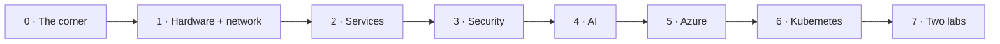

# Roadmap

The whole series, phase by phase. Episodes unlock as the videos drop. 🔒 = coming soon.

| Phase | | Status |
|---|---|---|
| **0** | The corner | 2 of 4 unlocked |
| **1** | Hardware and network | 🔒 6 episodes |
| **2** | Services | 🔒 6 episodes |
| **3** | Security | 🔒 3 episodes |
| **4** | AI | 🔒 3 episodes |
| **5** | Azure | 🔒 3 episodes |
| **6** | Kubernetes | 🔒 2 episodes |
| **7** | Two labs, one home | 🔒 3 episodes |

## Unlocked episodes

- **00** · [Documentation setup (behind the scenes)](episodes/ep00-documentation-setup.md)
- **01** · Trailer · [🎬 Watch](https://www.instagram.com/reel/Df0bnVlvBBL/)
